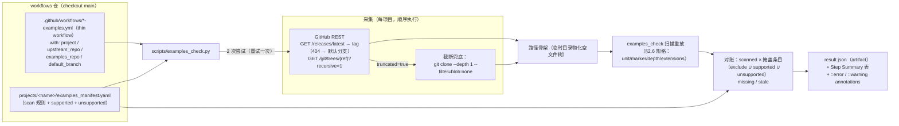
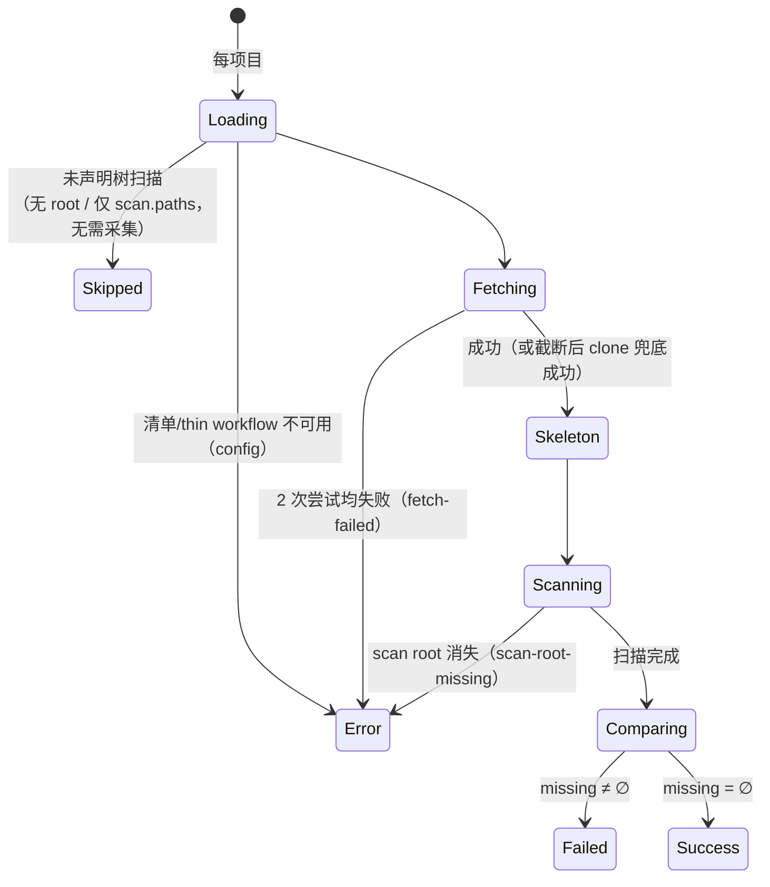

# examples-check 设计文档（example 清单对账）

## 1. 设计目的

### 1.1 现状与空缺

examples 看护的现役实现是共享引擎 `examples-template.yml` + `scripts/check_supported_entries.py`（30 个 thin workflow 经 `workflow_call` 调用）。为了把「清单合法性」和「新 example 发现」解耦，引擎**有意不扫描目标树**（`scripts/check_supported_entries.py:11-14` 的 docstring：*"Deliberately does NOT scan the target tree or compute new/stale diffs: discovering unclassified new upstream examples is a separate workflow's concern"*）。

也就是说，「上游新增了 example、清单还没登记」这件事，对**全部 31 个**带 `examples_manifest.yaml` 的项目**没有任何 CI 机制在看护**。diffusers 清单里甚至预先写好了对本文档所处位置的期待（`projects/diffusers/examples_manifest.yaml:10`：*"扫描工具的 exclude 支持随发现 workflow 的 PR 落地"*）。

### 1.2 设计目标

新增一个独立的定时 workflow：**每天一次，把每个项目的「上游 example 集合」与「清单 supported + unsupported 记录集合」对账**。

按用户需求形式化：

1. 直接扫**所有** example 项目（以 `projects/<name>/examples_manifest.yaml` 的存在为准），扫描规则直接读清单自己的 `scan` 段，不在新 workflow 里复制规则。
2. 上游比清单**多出**的（清单缺登）→ 逐条标出，该项目结果为 **error**；完全覆盖 → **success**。
3. 某个仓库获取失败 → **重试一次**，仍失败 → 该项目结果为 **error**（detail 记 fetch-failed），不影响其他项目。
4. 清单里的路径格式存在多种历史变体：**有限程度地支持**；无法廉价支持的，通过一次性调整存量数据（规范化）来支持。

### 1.3 设计定性

- 新增一个独立 workflow（`.github/workflows/examples-check.yml`）+ 一个引擎脚本（`scripts/examples_check.py`）+ 一个结果 schema。
- `examples_check.py` 自带完整的扫描重放实现，语义规格以本文档 §2.6 为唯一定义（含 `scan.exclude` 消费、`root: ''` 语义）；不依赖、不 import 任何共享扫描模块或 `bootstrap_manifest.py`。
- 不修改 examples 引擎（`examples-template.yml`、`check_supported_entries.py`）的任何行为。

### 1.4 设计基线

- `main`，commit `c50a11d9`（2026-10-08；初版基线为 `77a22c2`/2026-09-30，其间 legacy 流水线迁移全部完成）。
- 带清单项目 31 个：30 个有 thin workflow 在跑（本检查范围），ktransformers 看护未上线（不在范围）。
- 本文档中的「实测」数据来自 2026-09-30 用 GitHub Trees API 对 20 个代表性项目做的原型对账（见 §5.3）；其后清单仅零星改动（diffusers setup 脚本、areal cron），结论仍具代表性。

### 1.5 非目标

- 不校验 supported 条目的字段完整性（profile/runner/image/timeout）——那是 `check_supported_entries.py` 的职责。
- 不运行任何 example，不占 NPU runner。
- 不做 Issue 同步 / 事件去重（无状态纯审计）；那是 upstream-doc-monitor 的模式，本检查首轮不需要。
- 不做 release 变化的监听/事件触发（无状态纯审计）：ref 解析时只**查询**最新 release 作为对账基准（无 release 回落默认分支，见 §2.3），不追踪其变化历史。

## 2. 设计逻辑

### 2.1 概念空间

| 概念 | 定义 |
| --- | --- |
| **对账单位** | 沿用清单 `scan` 段定义的扫描单位（文件 / 目录 / mixed），与既有引擎同一口径。 |
| **上游集（scanned set）** | 按清单 scan 规则在**对账 ref**（最新 release；无 release 或分离模式回落扫描仓默认分支，与引擎源码拉取规则一致，见 §2.3）扫出的对账单位路径集合，路径相对**扫描仓根**。 |
| **记录集（recorded set）** | 清单折算出的「已登记路径」：supported 条目的 `path`（剔除 `source: project`）+ unsupported 段的字符串条目。 |
| **扫描仓（scan repo）** | 清单路径所相对的仓库：分离模式（deepspeed 式 examples_repo）下是 examples 仓，否则是 upstream_repo。 |
| **路径骨架（path skeleton）** | 把 Trees API 返回的 blob 路径在本地物化成「空文件 + 目录」的骨架树，供扫描重放（§2.3）在其上执行。 |
| **目录简写（directory shorthand）** | 记录条目是目录（或带尾斜杠）时，视为覆盖其下全部扫描单位。 |
| **覆盖（covered）** | 路径 p 被掩盖条目覆盖：p 等于某条目，或以某条目为目录前缀。掩盖条目 = 记录集 ∪ `scan.exclude`，三个名单（exclude / supported / unsupported）同一级别、同一套 §2.6.1 字面路径语义。 |
| **状态** | 每项目一个：`success` / `failed` / `error` / `skipped`（§2.5）。 |

### 2.2 总体数据流



### 2.3 核心问题一：不 clone 上游重放扫描规则（采集与规则实现）

对账的公信力取决于「重放的规则」与清单 scan 段声明的语义一致。本仓没有也不需要共享扫描代码：规则的单一来源是**本文档 §2.6 的语义规格**，examples_check 按规格实现并用单测固化（§5.2）；`bootstrap_manifest.py`（onboarding 初始化器，扫描逻辑内联其文件中）不是本检查的依赖——若其实现与规格漂移，属 onboarding 工具自身缺陷，在新项目接入后的首次对账即暴露。

**选择：Trees API 采集 + 路径骨架 + 规格内重放。**

- 采集（对账 ref 解析 + 树获取，与引擎源码拉取规则一致）：非分离模式先 `GET /repos/{repo}/releases/latest` 解析最新 release tag 作为对账 ref；无 release（404）回落默认分支——分支名从 thin workflow 的 `with.default_branch` 读（缺省 `main`，llama.cpp / whisper.cpp 声明 `master`），与引擎同源，不调 `/repos` 接口。分离模式（deepspeed）例外：examples 仓无 release，**总是其自身的默认分支**——从 repo 元数据解析（`GET /repos/{repo}` 的 `default_branch`，DeepSpeedExamples 是 `master`），不信任 `with.default_branch` 输入（那是给被监测主仓的回落值）；与引擎 examples checkout 不带 ref 的行为一致（`examples-template.yml:297-300`）。最后 `GET /repos/{repo}/git/trees/{ref}?recursive=1` 取全量 blob 路径；`target_ref` 记实际 ref（tag 或分支名），`ref_source` 记解析路径（`release` / `default-branch`）。每扫描仓 2 个调用，30 个受检项目约 60 个/天。扫描重放只消费路径形状（`is_file` / 后缀 / marker 存在性 / 深度），不读内容，所以把 blob 路径物化成空文件树后在骨架上执行，**实现即规格**。
- 实测（2026-09-30，匿名调用）：范围内最大树 onnxruntime 12,506 entries / 4.0 MB，`truncated=false`；transformers 2.5 MB、opencv 2.7 MB。GitHub 截断阈值是 100k entries / 7 MB，当前 31 仓全部远离阈值。仍保留兜底：`truncated=true` 时改用 `git clone --depth 1 --filter=blob:none`（只取树不取 blob）再物化；兜底也失败才判 error（fetch-failed）。
- 重试语义：**采集 = 上述调用对的完整尝试**。第一次失败（网络 / 5xx / 超时 / 404）→ 等待 10 s → 完整重试一次 → 仍失败 → `error`（fetch-failed）。项目间隔离：单项目 error 不中断循环。全部 30 仓顺序执行约 1–2 分钟（含每仓间 0.5 s 礼貌间隔），单 job 足够，不引入 matrix。
- 凭据：带 `GH_TOKEN`（workflow 里传 `github.token`），匿名 60 req/h 虽然也够（~62 调用/天），但带 token 可避开二级限流；持续 401/403 也归 `error`（凭据问题，detail 注明）。

**为什么不用 matrix + actions/checkout**：31 个全量 clone 每天 ~数 GB 流量且多数仓远大于其 example 树；API 方案每天 ~70 个请求、零 clone，且采集失败的失败域更小（一次 API 调用 vs 一次完整 checkout）。

**为什么以最新 release 为对账 ref（与引擎源码拉取规则一致）**：清单分类的对象就是引擎实际校验、运行的树——supported 登记的前提是在引擎会跑的 ref 上验证过；若对 main 对账，会把引擎根本不会测的 ref 上的新文件判成缺登，此时除盲登 unsupported 外无法处置（supported 要先跑通才能登记）。release tag 还是不可变快照，没有 main 半合并状态的竞态（§5.4）。无 release 的仓与分离模式的 examples 仓自动落到默认分支，与引擎同一条兜底链。代价是发现时机推迟到 release 发布——未发布的新 example 要等进 release 才被对账发现，这是与引擎保持同一棵树的自觉取舍。

### 2.4 核心问题二：对账判定（方向、覆盖规则、例外）

**记录集构造**（伪码）：

```python
recorded = set()
for entry in manifest['supported']:
    if entry.get('source', 'upstream') == 'project':
        continue                     # 工作仓自有用例，不在上游树里（ray 14 条、opencv 3 条、fla 1 条）
    recorded.add(entry['path'])
recorded.update(u for u in manifest['unsupported'] if isinstance(u, str))
```

**覆盖规则**（判定 scanned 路径 p 是否已登记）：

```python
covering = recorded | set(scan.exclude)   # 三个名单同级：exclude / supported / unsupported
def covered(p):
    for r in covering:
        r_norm = r.rstrip('/')               # 尾斜杠目录简写归一（opencv 用了 'samples/cpp/snippets/'）
        if p == r_norm or p.startswith(r_norm + '/'):
            return True                      # 字面命中或目录前缀覆盖；不做通配符解释（§2.6.1）
    return False
```

- **差集方向**：`missing = [p for p in scanned if not covered(p)]` 是唯一的判红条件；`stale = [r for r in covering if 未覆盖任何 scanned 路径]` 只进结果与日志，不判红——**三个名单（supported / unsupported / exclude）对称参与**：exclude 条目指错路径或上游已删时同样落 stale，成为清理线索。stale 含大量良性形态（deepspeed 的 supported 目录条目、trl 的 `examples/accelerate_configs` 这类非扫描扩展名目录、指向纯 `.md` 目录的 exclude），判红会是噪音；需求只关心「上游多了」。
- **目录简写的取舍**：记录条目 `examples/config` 会覆盖上游后续在该目录下新增的文件（roll 正是此意图：共享片段目录整体不登记）。代价是「目录下新文件不再被缺登检查发现」，这是清单作者用目录简写时显式选择的责任边界，可接受。
- **scan root 消失**（上游删/改名了 scan.root）：扫描重放报错 → 该项目 `error`，detail 注明 `scan-root-missing`。上游可达但结构巨变，需要人看，判红合理。
- **未声明树扫描 → `skipped`（绿，`::notice`）**：判定只看 scan 段有没有声明 `root`——scan 段整体缺失（flash-linear-attention：看护自有用例，`unsupported: []`）或只声明 `scan.paths` 允许清单逐个点名（ray：2 个指定上游测试文件 + 14 条自有用例），都等于「清单未声明要扫的树」，装载清单时即判定、跳过采集。两种情形：上游确实无用例（fla：examples/ 仅 1 个 training.md）；或上游 example 分散、无单一树可扫而清单选择不覆盖（ray：python/ray/{data,llm,air}/examples、cpp/example 等约 389 个脚本，扫 python/ray 会引入整个包源码，故只点名看护 2 个 NPU 测试文件）。不给这类项目强行编 scan root，也不按默认值猜树（旧实现的 root 缺省回落 `examples` 一并不再沿用）。与 scan-root-missing（§3.3 第 4 行）的分界：**声明了树却不存在 = 期待落空要红；未声明树 = 不适用跳过**。声明了 `root` 但 files / mixed 单位缺 `include_extensions` → error（config，声明不完整）；directories 单位配套 `marker` / `max_depth`（缺省取默认，llama.cpp 式）。
- **fla 类「纯 project 条目」项目**：无 scan 段 → `skipped`（见上条）。若将来要覆盖上游 example，补声明 scan 段即可纳入对账。

### 2.5 核心问题三：结果状态模型（完成 / 未完成 / 不适用）

每个项目的对账结果按「对账是否完成」分派：**完成了看有没有缺登（success / failed），没完成就是 error，本来就不适用则是 skipped**。error 不细分状态，细分原因（config / fetch-failed / scan-root-missing）进 `detail` 字段保留可观测性；skipped 专门标记**清单未声明树扫描**的情形（scan 段无 `root`：整体缺失，或只有 `scan.paths` 允许清单；上游无用例或显式选择不覆盖）。



| 状态 | 含义 | job | 注解 |
| --- | --- | --- | --- |
| `success` | 对账完成，上游集 ⊆ 记录集（匹配；stale 仅提示） | 绿 | — |
| `failed` | 对账完成，清单缺登（missing ≠ ∅）——本检查要抓的主结果 | **红** | `::error`，列出 missing（截断到前 20 条） |
| `error` | 对账未完成：config（清单 / thin workflow / 凭据）/ fetch-failed（采集重试后仍败）/ scan-root-missing（声明了 scan root 但上游不存在），细分原因进 detail | **红** | `::error` + detail |
| `skipped` | 清单未声明树扫描：scan 段无 `root`（整体缺失，或只有 `scan.paths` 逐个点名）——上游无用例，或 example 分散无单一树可扫而显式选择不覆盖 | 绿 | `::notice` |

**job 结论 = 引擎退出码**：任一 `failed` 或 `error` → exit 1（workflow 红）；全部 `success` / `skipped` → exit 0。全局致命错误（一个可解析的 thin workflow 都没有、CLI 用法错）→ exit 2。

> 取舍说明：error 内部不再区分上游侧/本仓侧（曾沿用 upstream-doc-monitor「上游侧失败不判红」的哲学），fetch-failed 也计入红——重试一次兜底后仍持续失败本就值得人看；换来的是消费方（看板/告警）只需理解四个词。

### 2.6 路径格式的有限支持与规范化

实测盘点 31 个清单后，路径格式变体及处理如下。「**要求调整**」列是为支撑检查需要做的一次性存量数据修正：

| # | 变体 | 实例 | 处理 | 要求调整 |
| --- | --- | --- | --- | --- |
| 1 | 路径相对扫描仓根 | 全部 31 项目 | 直接支持（扫描重放返回仓根相对路径） | 无 |
| 2 | unsupported 为纯字符串 | 全部 31 项目 | 直接支持；出现 dict 条目 → `error`（config） | 无 |
| 3 | 目录简写条目（无尾斜杠） | deepspeed `applications/DeepSpeed-Chat/dschat`、roll `examples/config` | 前缀覆盖规则 | 无 |
| 4 | 目录简写条目（尾斜杠） | opencv `samples/cpp/snippets/` | `rstrip('/')` 后走前缀规则 | 无 |
| 5 | 通配符条目 | opencv `**/__pycache__` | 不支持——按字面处理，永不命中（落 stale 提示，不判红） | **改写为完整路径（目录或文件）或删除** |
| 6 | `source: project` 条目 | ray 14、opencv 3、fla 1 | 剔除出记录集 | 无 |
| 7 | 未声明树扫描：scan 段缺失或只有 `scan.paths` | ray（上游 example 分散无单一树，选择不覆盖）、flash-linear-attention（上游无用例） | `skipped`（绿，装载清单时即判定，跳过采集） | 无 |
| 8 | `scan.exclude` 声明 | areal、diffusers | **本设计落地消费**（§2.6.2，与 supported/unsupported 同级掩盖，字面路径语义） | **areal 12 条、diffusers 8 条含通配符的 exclude 条目改写为完整路径**（`dir/**` 去后缀即目录；`**/xxx` 逐文件列出或按目录排除）——不改则这些条目全部落 stale，且它们原本想掩盖的 helper/测试文件成为 missing（failed，自然的强制力） |
| 9 | `root: ''`（仓根） | deepspeed、torch.vision | **显式空串 = 仓根**：实测暴露的历史 bug 是 `'' or 'examples'` 回落成 `examples/`，已随 bootstrap 内联顺带修复；examples_check 按 §2.6 规格实现同一语义 | 无 |
| 10 | 分离模式 examples_repo | deepspeed | 从 deepspeed-examples.yml 的 `with.examples_repo` 读（运行 yaml 里已声明） | 无 |
| 11 | 登记表指向与实际看护树不一致 | torch.vision（projects.yaml 写 `Ascend/vision`，实际看护 `pytorch/vision`）、onnxruntime（projects.yaml 写 `microsoft/onnxruntime`，实际看护 `microsoft/onnxruntime-inference-examples`，且该仓无 release 走默认分支） | **本检查不读 projects.yaml**，repo / 回落分支一律来自实际运行的 thin workflow（按构造正确，漂移不可能） | 无（对检查而言）；登记表数据错误作为独立待办另行修正，供人读与其他消费者 |
| 12 | `max_depth` 声明于 files 单位下（引擎不消费） | aibrix、bitsandbytes | 按 bootstrap 内联实现的历史口径重放（不消费） | 另行规范化（删声明或让 files 单位消费），不在本设计范围，见 §5.4 |

#### 2.6.1 路径条目语义（exclude 与记录集条目共用）

只认**字面路径，明确不支持 `*` / `**` / `?` 通配符**。每条路径要么是文件、要么是目录：

- 文件路径：精确匹配该对账单位。
- 目录路径：递归覆盖其下全部扫描单位（前缀匹配 `dir + '/'`）；尾斜杠归一（`a/b/` ≡ `a/b`）。
- **三个名单的路径规则完全一致，不做任何路径内容校验**：含通配符 / 绝对路径 / `..` / 笔误的条目，效果都一样——按字面匹配不到任何单位 → 落 stale，成为清理线索。类型层面仍校验：exclude / unsupported 必须是字符串列表，出现非字符串条目 → error（config）。

> 原型阶段曾实现 gitignore 式 glob（`**` 跨目录等），两个原因放弃：其一，`**` 的正则翻译存在分隔符陷阱（`**` 段自带 `/` 后再 join 会要求双斜杠），语义边角多、实现与测试成本高；其二，实测存量 exclude 69 条中 49 条本就是字面路径，通配只占少数。完整路径（目录或文件）表达力足够，且让清单作者显式写清排除对象，可读性更好。

#### 2.6.2 `scan.exclude` 的消费

examples_check 装载 `scan.exclude`（字符串列表；路径内容不校验，见 §2.6.1——歪条目自然落 stale），其条目与 supported / unsupported **同一级别**参与 covered() 与 stale 判定（§2.4 的 `covering` 并集），不做独立的前置剪枝——这正是 diffusers/areal 清单声明 exclude 时预设的交付方式。`bootstrap_manifest.py` 不消费 exclude：它重新生成清单时整文件覆盖，exclude 段与 unsupported 注释本就需要人工回填（其 docstring 已注明）。

实测效果（diffusers，2026-09-30）：原始扫描 308 条中 178 条被 exclude 条目掩盖，参与对账 130 条 → 真实缺登从 176 条收敛到 **3 条**（dreambooth×2、research_projects/sana×1）。exclude 的语义边界：**exclude 声明「这类不是 example」**（helper/自测/实现文件），**unsupported 登记「是 example 但本体系不跑」**，两者不混用。

### 2.7 与既有模块的关系

| 模块 | 职责 | 与本设计的关系 |
| --- | --- | --- |
| `check_supported_entries.py`（引擎 manifest-check） | 校验 supported 字段完整性、派发矩阵 | 互不重叠：本检查只看覆盖，不看字段 |
| thin workflow（`*-examples.yml`，30 个） | 引擎的运行时触发器与 `with:` 输入声明 | 本检查的单一事实来源：扫描仓、回落分支全部从这里读，不读 projects.yaml |
| `bootstrap_manifest.py`（onboarding 工具，扫描逻辑内联） | 初始化清单（docstring 明示 CI 不调用） | 不是本检查的依赖；scan 段语义规格归本文档 §2.6，其实现与规格的偏差属自身缺陷，接入后首次对账即暴露 |
| upstream-doc-monitor | 上游文档变化 → Issue | 模式参考（错误归属哲学）；本检查无状态、无 Issue |

## 3. 核心数据结构

### 3.1 聚合结果 `result.json`

```json
{
  "schema_version": 1,
  "trigger": "schedule",
  "run_at": "2026-09-30T01:20:03Z",
  "workflows_ref": "c50a11d9…",
  "summary": { "success": 8, "failed": 10, "error": 1, "skipped": 1 },
  "projects": [
    {
       "project": "torchtune",
      "status": "failed",
      "scan_repo": "meta-pytorch/torchtune",
      "target_ref": "v0.6.1",
      "ref_source": "release",
      "tree_sha": "bd2a0fc7…",
      "scanned_count": 23,
      "recorded_count": 21,
      "missing_paths": [
        "recipes/dev/async_grpo_full_finetune_distributed.py",
        "recipes/qat_single_device.py"
      ],
      "stale_paths": [],
      "detail": ""
    },
    {
      "project": "ray",
      "status": "skipped",
      "scan_repo": "ray-project/ray",
      "scanned_count": 0,
      "recorded_count": 0,
      "missing_paths": [],
      "stale_paths": [],
      "detail": "no scan root declared (scan.paths allowlist mode)"
    }
  ]
}
```

| 字段 | 说明 |
| --- | --- |
| `status` | 枚举 `success / failed / error / skipped`（§2.5 表） |
| `scan_repo` / `target_ref` / `ref_source` / `tree_sha` | 实际扫描的仓库、对账 ref（release tag 或分支名）、ref 解析路径（`release` / `default-branch`）、树 SHA（可追溯性）；skipped 时对账 ref 三项为空（未采集） |
| `missing_paths` | 上游有、清单未覆盖的对账单位（判红依据，全量列出） |
| `stale_paths` | 掩盖条目（supported / unsupported / exclude）中上游已无对应者（提示，不判红） |
| `detail` | error 的细分原因（config / fetch-failed / scan-root-missing）或 skipped 的原因，含具体信息 |

schema 落盘为 `schemas/examples_check_result.schema.json`（draft-07，与 `result.schema.json` 同风格），CI 内用 check-jsonschema 校验后再上传 artifact。

### 3.2 thin workflow 读模型（单一事实来源 = 实际运行的 yaml）

projects.yaml 只是手工维护的登记表，已实测漂移两处（torch.vision、onnxruntime，§2.6 第 11 行）。本检查**不读注册表**，数据源是实际要运行的 thin workflow——引擎运行时用的就是这些 `with:` 输入，按构造不可能与实际不符：

```yaml
# .github/workflows/deepspeed-examples.yml（节选）
jobs:
  deepspeed-examples:
    uses: ./.github/workflows/examples-template.yml
    with:
      project: deepspeed
      upstream_repo: deepspeedai/DeepSpeed
      examples_repo: deepspeedai/DeepSpeedExamples   # 分离模式的扫描仓（仅 deepspeed）
      default_branch: master                          # 无 release 回落分支（缺省 main）
```

读取规则（PyYAML 解析，无需任何 API）：

- **数据源** = `.github/workflows/*.yml` 中存在 job `uses: ./.github/workflows/examples-template.yml` 的文件（现 30 个），提取 `with` 的 `project` / `upstream_repo` / `examples_repo`（可选）/ `default_branch`（可选，缺省 `main`；llama.cpp、whisper.cpp 声明 `master`）。
- **项目集** = thin workflow ∩ 有 `examples_manifest.yaml`。有清单无 workflow 的项目（ktransformers：看护未上线）不在范围，Step Summary 备注一行。
- **扫描仓** = `examples_repo` 存在 ? `examples_repo` : `upstream_repo`。
- `with.upstream_repo` 缺失 → `error`（config）（模板 input 为 required，实际必在，防手写坏文件）。

### 3.3 状态判定表

| 判定顺序 | 条件 | 状态 |
| --- | --- | --- |
| 1 | 清单 YAML 不可解析 / unsupported 或 exclude 含非字符串 / thin workflow 缺 upstream_repo / scan 配置非法（unit、max_depth、include_extensions 等结构性错误，含声明了 root 但 files/mixed 缺 include_extensions） | `error`（config） |
| 2 | 采集 2 次尝试均失败 | `error`（fetch-failed） |
| 3 | scan 段未声明 `root`（整体缺失或只有 `scan.paths`）——上游无用例或显式选择不覆盖 | `skipped` |
| 4 | scan root 在扫描仓不存在 | `error`（scan-root-missing） |
| 5 | `missing ≠ ∅` | `failed` |
| 6 | 其余 | `success` |

## 4. 接口定义

### 4.1 引擎 CLI

```text
python3 scripts/examples_check.py \
  --workflows-dir .github/workflows \
  --projects-root projects \
  --output result.json

环境变量：GH_TOKEN（可选但强烈建议；持续 401/403 判 error）
退出码：0 = 全部 success / skipped；1 = 存在 failed 或 error；2 = 全局致命（无任何可解析的 thin workflow、用法错误）
副产物：$GITHUB_STEP_SUMMARY 追加 Markdown 结果表；stdout 打 ::error/::warning/::notice 注解
```

引擎内部函数保持可导入（`load_registry` / `build_recorded_set` / `covered` / `reconcile` / `fetch_tree`），`fetch_tree` 以参数注入便于测试替身。

### 4.2 Workflow 骨架

```yaml
name: examples-check
on:
  schedule:
    - cron: '20 1 * * *'        # 每日一次；09:20 北京时间，错开整点 cron 高峰
  workflow_dispatch:

permissions:
  contents: read

jobs:
  check:
    runs-on: ubuntu-latest       # 纯 API 审计，无 NPU
    timeout-minutes: 30
    steps:
      - uses: actions/checkout@v4
      - run: python3 -m pip install -q pyyaml
      - run: python3 scripts/examples_check.py
            --workflows-dir .github/workflows
            --projects-root projects
            --output result.json
        env:
          GH_TOKEN: ${{ github.token }}
      - name: Validate result.json
        run: |
          python3 -m pip install -q "check-jsonschema==0.38.0"
          check-jsonschema --schemafile schemas/examples_check_result.schema.json result.json
      - if: always()
        uses: actions/upload-artifact@v4
        with:
          name: examples-check-${{ github.run_id }}
          if-no-files-found: error
          path: result.json
```

Step Summary 表（引擎渲染）：

```text
| project | status | scan_repo@ref | scanned | recorded | missing | stale | detail |
| ------- | ------ | ------------- | ------- | -------- | ------- | ----- | ------ |
| torchtune | error | meta-pytorch/torchtune@main | 23 | 21 | 2 | 0 |  |
| ray | skipped | ray-project/ray | – | – | – | – | no upstream example tree |
```

### 4.3 扫描重放实现（examples_check 内部）

examples_check.py 内含 scan 段解释器：root（显式 `''` = 仓根，未写回落 `examples`）/ unit / marker / max_depth / include_extensions / exclude（§2.6.1 字面语义，与 supported/unsupported 同级参与掩盖与 stale 判定；通配符不解释不报错，歪条目自然落 stale），语义规格 = §2.6，由 §5.2 的单测固化。引擎不 import 任何共享扫描模块；`bootstrap_manifest.py` 不做任何改动（其内联实现已于 2026-10-08 落地，`root: ''` 语义与规格一致，exclude 不消费）。

### 4.4 接口关系总结

对应用户目标的一句话映射：**要发现「上游 example 比清单多了」，每天定时一次**——workflow `examples-check.yml` 定时唤起 `examples_check.py`；引擎从 thin workflow（实际运行的 yaml）取扫描仓与回落分支、从各清单取 scan 段，经 `fetch_tree`（解析对账 ref：最新 release，无 release / 分离模式回落默认分支，与引擎拉取规则一致；重试一次，败则 error）拿到路径骨架，按 §2.6 规格重放扫描得到上游集，与 `build_recorded_set()` 折算的记录集做覆盖对账；missing 非空即 failed，failed 或 error 任一存在即 exit 1（workflow 红），完全覆盖即 success，未声明树扫描（scan 段无 root）即 skipped，结果落 `result.json` artifact 与 Step Summary，供人分类新 example 后合入清单，次日恢复 success。

## 5. 一致性校验

### 5.1 设计要素综合检查

- **概念一致性**：全文统一「对账单位 / 上游集 / 记录集 / 扫描仓 / 路径骨架 / 目录简写 / 覆盖」；「对账单位」与既有清单注释（roll、trl）同词。error 的三类原因（config / fetch-failed / scan-root-missing）全文同词；skipped 专指上游没有用例目录。
- **状态完备性**：对账完成 → success / failed（missing 是否为空）；对账未完成 → error（config / fetch-failed / scan-root-missing 三类原因记入 detail）；对账不适用（上游没有用例目录）→ skipped。无未分类异常路径（未预期异常按 error 兜底并带堆栈进 detail）。
- **接口完备性**：§1.2 的 4 条需求分别由 cron（需求 3 的定时）、`fetch_tree` 重试、状态枚举、§2.6 规范化表承接；CLI / workflow / schema / summary 四个交付面互相引用一致。
- **层次一致性**：不做字段校验（引擎职责）、不跑 example（NPU 职责）、不做 Issue 同步（doc-monitor 职责）；exclude 语义只在 §2.6 定义一处，examples_check 是其唯一 CI 实现（bootstrap 不消费）。

### 5.2 测试计划（`tests/test_examples_check.py`，unittest 风格）

1. 记录集：`source: project` 剔除；unsupported 字符串并入；unsupported 出现 dict → error（config）。
2. 覆盖规则：字面命中；目录简写（含尾斜杠归一）；前缀不误伤（`foo` 不覆盖 `foo.py`）；通配符条目按字面处理不命中（落 stale）。
3. 差集方向：missing 判红、stale 不判红；`covered` 双向（stale = 未覆盖任何上游路径的掩盖条目；exclude 条目指错路径同样落 stale）。
4. 状态映射：fetch 替身连续失败 2 次 → error（fetch-failed）且不影响后续项目；scan 段无 root（整体缺失 / 仅 scan.paths）→ skipped（且不发起采集）；有 root 但 files/mixed 缺 include_extensions → error（config）；scan root 缺失 → error（scan-root-missing）；missing ≠ ∅ → failed；failed/error 任一存在即 exit 1。
5. exclude（同级掩盖）：字面目录覆盖（含尾斜杠）、精确文件；仅匹配 exclude 条目的单位不算 missing；含 `*` / `?` / 绝对路径 / `..` 的条目不报错，按字面永不命中 → 落 stale；非字符串条目 → error（config）。
6. root 语义：显式 `root: ''` = 仓根；未写 root → skipped（不做默认回落）。
7. 端到端：临时目录造骨架树 + 临时清单，跑 `main()` 断言 result.json 与退出码。
8. thin workflow 解析（数据守门）：每个调用 examples-template.yml 的 workflow 都能提取 `with.project` / `with.upstream_repo`；`with.project` 与 `projects/<project>/examples_manifest.yaml` 一一对应（ktransformers 有清单无 workflow → 不在范围并在 summary 备注）；deepspeed 的 `with.examples_repo` 提取正确。

### 5.3 首轮运行结果（2026-10-08 引擎落地后全量实跑，30/30 项目）

> 真实数据（对账 ref 按 §2.3 release 规则解析）。2026-09-30 的原型按默认分支 HEAD 测得，方向一致；release 基准下 main 领先部分消失——torchtune、xtuner 原型的缺登在 release 上不存在，落 success。

| 结果 | 项目（missing 数） |
| --- | --- |
| success（16） | accelerate(43/43)、aibrix(5/5)、bitsandbytes(5/5)、cache-dit(7/8)、liger-kernel(17/17)、llm-compressor(159/159)、mooncake(18/18)、**onnxruntime(77/77，@main——读 thin workflow 自动用对 onnxruntime-inference-examples，登记表漂移不再影响)**、opencv(468/181，@v5.0.0)、peft(112/112)、speculators(13/13)、tensordict(14/14)、torchtune(21/21，@v0.6.1)、transformers(96/96)、whisper.cpp(42/31，files 模式，stale 5 为视野外移植端口)、xtuner(11/11，@v0.2.0) |
| failed·真实缺登（9） | llama.cpp(+1)、trl(+1)、xllm(+1)、specforge(+2)、slime(+6)、ms-swift(+7)、roll(+34)、diffusers(+47——exclude 通配未迁移的自然强制力：test_* / conftest 无人掩盖)、areal(+66，同前) |
| failed·结构性欠账（3） | torch.vision(+298，25 条对 323 单位)、torchtitan(+235，包源码树模型)、deepspeed(+86，@master) |
| skipped（2） | ray（scan.paths）、flash-linear-attention（无 scan 段） |

**首轮大批 error 是特性而非缺陷**：结构性欠账的四个项目（torchtitan 扫包源码树、onnxruntime root=`.` 扫全仓、opencv samples 全量、deepspeed 快照老化）正好暴露了「清单与 scan 规则的匹配度」问题，处置路径二选一：把缺登单位补进 unsupported（逐条注释），或用 `scan.exclude` 收窄「什么算 example」。cron 一开即判红：triage 收敛前 run 会持续红，这本身就是驱动分类的信号。

### 5.4 遗留与风险

- **fetch-failed 的持续可见性**：连续 fetch-failed（error）靠每日 summary/annotation 曝光并判红，无升级机制；若后续需要，可复用 upstream-doc-monitor 的 Issue 模式（独立迭代，不阻塞本设计）。
- **默认分支竞态（仅限无 release 回落 / 分离模式的扫描仓）**：release tag 是不可变快照，无竞态；回落默认分支的仓（onnxruntime-inference-examples、DeepSpeedExamples）取瞬时 HEAD 树，半合并状态的文件会短暂出现/消失，日频审计下自愈（次日复对），不引入状态。
- **`max_depth` 声明于 files 单位不生效**（aibrix、bitsandbytes）：本轮按 bootstrap 内联实现的历史口径重放（files 单位不消费 max_depth）保持清单/对账一致，另开规范化 issue 决定「删声明」还是「让 files 单位消费」。
- **文档同步**：`docs/guarding-examples.md` 要求 3 应补一段指向本文档（新 example 发现职责的归属说明）。

## 6. 变更历史

| 日期 | 变更内容 | 原因 |
| --- | --- | --- |
| 2026-09-30 | 初版：覆盖对账 workflow 设计（采集/对账/状态机/路径格式规范化/exclude 落地），含 20 项目原型实测 | 填补 examples 引擎移除 new/stale 发现后的空缺（用户需求：每日对账 supported+unsupported、缺登判红、获取失败重试一次后 miss、路径格式有限支持）
| 2026-10-08 | 基线更新至 `c50a11d9`：legacy 内联流水线迁移全部完成，`check_examples_manifest.py` 确认为退役代码（无 CI 调用方）；§1.1 现状、§2.7 模块关系、§4.3 消费者名单、§5.4 清理建议同步修订 | 仓库演进导致初版现状描述过期（更新代码后重新分析） |
| 2026-10-08 | 删除 legacy 三件套（`check_examples_manifest.py` / `templates/project-examples.yml` / `manifest_check_result.schema.json`）并拆分其测试；§1.1、§2.7、§4.3、§5.4 由「退役/建议清理」改为「已删除」 | 执行 §5.4 清理建议（用户确认删除） |
| 2026-10-08 | `scripts/examples_manifest_scan.py` 内联进 `bootstrap_manifest.py` 并删除（顺带修复 `root: ''` 语义，测试随迁为 `tests/test_bootstrap_manifest.py`）；设计去共享模块化：§2.3/§2.6/§2.7/§4.3/§5.2 改为「examples_check 自带重放实现，规格单一来源 = §2.6」 | 用户决策：检查不依赖共享扫描模块，bootstrap 仅为 onboarding 初始化器 |
| 2026-10-08 | §2.6.1 改为字面路径语义：明确不支持 `*` / `**` / `?` 通配；exclude 含通配符 → config_error，存量 areal 12 条 / diffusers 8 条需迁移为完整路径；covered() 去通配分支，§4.3 / §5.2 用例同步 | 用户决策：通配实现与测试成本高、存量主体本就是字面路径，清单统一要求写完整路径（目录或文件） |
| 2026-10-08 | 对账 ref 由「默认分支 HEAD」改为与引擎源码拉取规则一致：最新 release，无 release 回落默认分支（分离模式 examples 仓恒为默认分支）；result.json 增 `ref_source`；比对全部 thin workflow 又发现 onnxruntime 注册表同款漂移（实际看护 onnxruntime-inference-examples），§2.6 表第 11 行、§5.3 相应修正 | 用户决策：对账基准应与 example 源码拉取规则一致 |
| 2026-10-08 | 状态机由五态收敛为三态：缺登改判 `failed`，config_error / fetch-failed（原 miss）/ scan-root-missing / allowlist（原 skipped）统一为 `error`（细分原因进 detail）；job 判红改为「任一 failed 或 error」；ray 的允许清单模式从良性 skipped 变为持续 error（显式信号：要么定义 scan 规则要么将来加注册表豁免） | 用户决策：skipped 无存在必要，状态模型按「对账完成与否」二分 + failed/error 语义分离 |
| 2026-10-08 | 恢复 `skipped`，语义收窄为「上游没有用例目录」（scan.paths 允许清单，装载清单时判定、跳过采集，绿）；scan-root-missing 维持 error（声明了树却不存在 = 期待落空）；状态模型 = 完成（success/failed）/ 未完成（error）/ 不适用（skipped） | 用户决策：skipped 专门标记上游无用例目录的情形 |
| 2026-10-08 | skipped 判定改为声明驱动：只看 scan 段是否声明 `root`（整体缺失或仅 `scan.paths` 均判 skipped，不再按默认 root=examples 猜树）；flash-linear-attention 无 scan 段随之从 success 改判 skipped；声明 root 但 files/mixed 缺 include_extensions → error（config） | 用户决策：skip 就看 root / include_extensions 字段定义，没有定义就 skip |
| 2026-10-08 | 实测澄清 skipped 的两种情形：fla 上游确实无用例（examples/ 仅 training.md）；ray 上游有约 389 个分散 example 脚本（python/ray/*/examples、cpp/example 等，无单一树可扫），其 skipped 是清单显式选择不覆盖——§2.4/§2.5/§2.6 措辞由「上游没有用例目录」改为「清单未声明树扫描」 | 用户问询驱动的事实核查 |
| 2026-10-08 | 数据源由 projects.yaml 注册表改为 thin workflow（实际运行的 yaml）：扫描仓 / examples_repo / 无 release 回落分支一律从 `with:` 输入读，按构造正确；登记表增量（deepspeed examples_repo）与两处指向修正（torch.vision / onnxruntime）从检查的前置项降为独立待办；API 调用降为每仓 2 个 | 用户决策：登记表只是登记表、数据会错，应从实际要运行的 yaml 里读 |
| 2026-10-08 | exclude 由「扫描后的前置剪枝阶段」改为与 supported / unsupported 同级的掩盖名单：covered() 对 `recorded ∪ scan.exclude` 并集判定，管线由两层并为一层；missing/stale 结果不变（stale 仍只统计 supported/unsupported 条目，exclude 条目不参与） | 用户决策：exclude 不先剪，三个名单一个级别 |
| 2026-10-08 | stale 判定对称化：exclude 条目与 supported / unsupported 一样参与失效统计（`covering` 全集逐条判），exclude 指错路径或上游已删时落 stale 作清理线索；良性形态（非扫描扩展名目录、纯 .md 目录的 exclude）照旧不判红 | 用户决策：exclude 也应放入 stale |
| 2026-10-08 | exclude 路径规则与 supported/unsupported 完全对齐：去掉「含通配符 → error(config)」的特殊校验，歪条目（通配/绝对路径/`..`/笔误）统一按字面永不命中 → 落 stale；类型校验（非字符串条目）仍为 config error；areal/diffusers 迁移的强制力从 config error 换成 missing（不迁移则原本想排除的文件成为缺登） | 用户决策：exclude 路径规则应和 supported 类似，不要通配符 |
| 2026-10-08 | whisper.cpp 由 mixed 改为 files 对账（`+.cpp`，6 个顶层共享 helper 进 `scan.exclude`）：单位 42、missing 0、stale 5（Java/Lua/ObjC/Swift 移植无 C++ 源，视野外提示）；§5.2 用例 6 修正为「未写 root → skipped」（实现前发现的设计残留） | 用户决策：whisper.cpp 走文件形式，按设计文档实现 |
| 2026-10-08 | 落地实现：`scripts/examples_check.py` + `.github/workflows/examples-check.yml` + `schemas/examples_check_result.schema.json` + `tests/test_examples_check.py`（34 用例，全仓 125 测试绿）；全量实跑 30/30（success 16 / failed 11 / skipped 2，数据见 §5.3）；实现期修复两处：curl 认证头插入错位、分离模式默认分支误用 `with.default_branch`（改为 repo 元数据解析） | 用户决策：按设计文档实现 |
| 2026-10-08 | 移除 `--report-only` / `report_only` 输入（workflow、CLI、测试、§5.3 上线建议同步）：红绿从第一天起就是机器可读信号，不留逃生门 | 用户决策：不需要 report_only |
| 2026-10-08 | 移除 `--project` 子集输入（workflow、CLI、测试同步）：全量 30 仓顺序执行仅 1–2 分钟，无需子集运行 | 用户决策：不需要，反正很快 |
